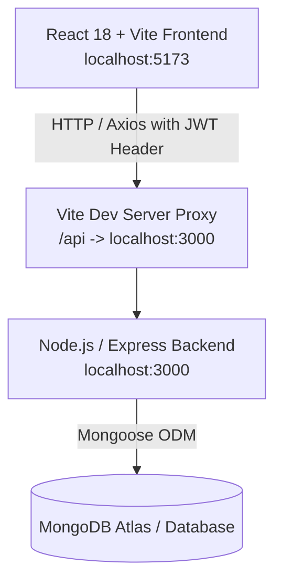
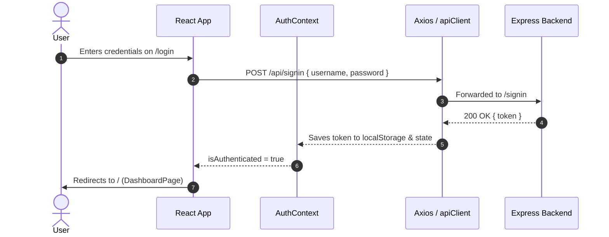

# Full-Stack Trello Clone — Complete Project & Architecture Documentation

A modern, agile project management and Kanban workspace application built with an **Express / MongoDB** backend and a **React 18 / Vite / TypeScript / Tailwind CSS** frontend.

---

## 1. High-Level Architecture



---

## 2. Technology Stack

### Backend
- **Runtime**: Node.js
- **Framework**: Express.js (v5)
- **Database & ODM**: MongoDB with Mongoose (v9)
- **Authentication**: JSON Web Tokens (`jsonwebtoken`) & `bcrypt` password hashing
- **Validation**: Zod schema validation
- **Configuration**: Dotenv (`dotenv`)

### Frontend
- **Framework**: React 18 with Vite
- **Language**: TypeScript (with strict mode and `verbatimModuleSyntax`)
- **Styling**: Tailwind CSS v4 (`@tailwindcss/vite`), custom glassmorphism design system
- **Icons**: Lucide React
- **Routing**: React Router DOM (v7)
- **HTTP Client**: Axios with custom request/response interceptors
- **Kanban Drag-and-Drop**: `@hello-pangea/dnd`

---

## 3. Database Schema & Data Models

Derived from [models.js](file:///Users/ankulparmar/tech/web_dev/projects/trello/models.js):

### 1. User (`users`)
```typescript
interface User {
  _id: ObjectId;
  username: string;
  email: string;
  password: string; // bcrypt hash
}
```

### 2. Organization / Workspace (`organizations`)
```typescript
interface Organization {
  _id: ObjectId;
  title: string;
  description?: string;
  adminId: ObjectId;  // User who created the workspace
  members: ObjectId[]; // Array of User IDs with member access
}
```

### 3. Board (`boards`)
```typescript
interface Board {
  _id: ObjectId;
  title: string;
  orgId: ObjectId;    // Reference to Organization
}
```

### 4. Issue / Card (`issues`)
```typescript
interface Issue {
  _id: ObjectId;
  title: string;
  boardId: ObjectId;  // Reference to Board
  status: "next_up" | "in_progress" | "done";
}
```

---

## 4. Backend Endpoints & API Reference

### Authentication (`/signup`, `/signin`)
| Method | Endpoint | Request Body | Headers | Description |
| :--- | :--- | :--- | :--- | :--- |
| `POST` | `/signup` | `{ username, email, password }` | None | Registers new user account |
| `POST` | `/signin` | `{ username, password }` | None | Authenticates user and returns JWT token |

### Workspaces / Organizations (`/organization`)
| Method | Endpoint | Params / Body | Headers | Description |
| :--- | :--- | :--- | :--- | :--- |
| `GET` | `/organization` | None | `token: <JWT>` | Returns all organizations where user is admin |
| `POST` | `/organization` | `{ title, description? }` | `token: <JWT>` | Creates a new organization/workspace |
| `DELETE`| `/organization` | Body: `{ organizationId }` | `token: <JWT>` | Cascade deletes all boards, issues, and the organization |

### Members (`/member`)
| Method | Endpoint | Params / Body | Headers | Description |
| :--- | :--- | :--- | :--- | :--- |
| `GET` | `/member` | Query/Body: `organizationId` | `token: <JWT>` | Returns list of member user IDs for an org |
| `POST` | `/member` | Body: `{ organizationId, memberUserUsername }` | `token: <JWT>` | Adds an existing user as workspace member |
| `DELETE`| `/member` | Body: `{ organizationId, memberId }` | `token: <JWT>` | Removes a member from the workspace (admin only) |

### Boards (`/board`)
| Method | Endpoint | Params / Body | Headers | Description |
| :--- | :--- | :--- | :--- | :--- |
| `GET` | `/board` | Query/Body: `organizationId` | `token: <JWT>` | Returns all boards within an organization |
| `POST` | `/board` | Body: `{ organizationId, title }` | `token: <JWT>` | Creates a new Kanban board |

### Issues / Tasks (`/issue`)
| Method | Endpoint | Params / Body | Headers | Description |
| :--- | :--- | :--- | :--- | :--- |
| `GET` | `/issue` | Query/Body: `organizationId, boardId` | `token: <JWT>` | Fetches all cards/issues belonging to a board |
| `POST` | `/issue` | Body: `{ organizationId, boardId, title }` | `token: <JWT>` | Creates a new card with initial status `next_up` |
| `PUT` | `/issue` | Body: `{ organizationId, boardId, issueId }` | `token: <JWT>` | Transitions issue status: `next_up` -> `in_progress` -> `done` |
| `DELETE`| `/issue` | Body: `{ organizationId, boardId, issueId }` | `token: <JWT>` | Deletes an issue |

---

## 5. Frontend Architecture & Directory Layout

```
frontend/
├── index.html                           # App HTML template with Inter/Outfit typography & SVG favicon
├── package.json                         # Dependencies & scripts
├── vite.config.ts                       # Vite config with @tailwindcss/vite and /api reverse proxy
├── tsconfig.json                        # Root TypeScript config
├── tsconfig.app.json                    # Client TypeScript config (verbatimModuleSyntax enabled)
├── src/
│   ├── main.tsx                         # App entrypoint
│   ├── App.tsx                          # BrowserRouter & Route declarations
│   ├── index.css                        # Tailwind v4 theme, custom scrollbars, and glassmorphism
│   ├── types/
│   │   └── api.ts                       # Strongly-typed API models & DTO interfaces
│   ├── services/
│   │   ├── apiClient.ts                 # Axios client with JWT request interceptor & error handling
│   │   ├── authService.ts               # Signin & signup API methods
│   │   ├── orgService.ts                # Workspace CRUD & member management methods
│   │   ├── boardService.ts              # Boards fetching & creation methods
│   │   └── issueService.ts              # Issue creation, deletion, and drag-and-drop status syncing
│   ├── context/
│   │   └── AuthContext.tsx              # React Auth state with localStorage persistence & auto-session restoration
│   ├── components/
│   │   ├── auth/
│   │   │   └── ProtectedRoute.tsx       # Route guard redirecting unauthenticated users to /login
│   │   ├── layout/
│   │   │   ├── Navbar.tsx               # Top glassmorphic header with active workspace switcher & profile
│   │   │   └── Sidebar.tsx              # Collapsible workspace & board navigation sidebar
│   │   └── ui/
│   │       ├── Button.tsx               # Polymorphic button with loading spinner, variants, and icons
│   │       ├── Input.tsx                # Accessible text/password input with icon and error slots
│   │       ├── Modal.tsx                # Accessible dialog with backdrop blur & Escape key dismissal
│   │       └── Badge.tsx                # Color-coded status badges for Kanban tasks
│   └── pages/
│       ├── LoginPage.tsx                # User sign-in view
│       ├── RegisterPage.tsx             # User registration view (with auto-login)
│       ├── DashboardPage.tsx            # Organization overview, member modal, and boards grid
│       └── BoardPage.tsx                # 3-column Kanban board with drag-and-drop (@hello-pangea/dnd)
```

---

## 6. Key Workflows

### 1. Authentication & Route Guarding Flow


### 2. Drag-and-Drop Kanban Status Synchronization
When a card is dragged between columns:
1. **Optimistic Local Update**: `@hello-pangea/dnd` triggers `onDragEnd`. The card's state is immediately updated in React state for a 60 FPS fluid drag-and-drop experience.
2. **Backend Status Synchronization**: `issueService.syncIssueStatus(orgId, boardId, issue, targetStatus)` executes the necessary status transition:
   - `next_up` -> `in_progress`: 1 `PUT /issue` call.
   - `next_up` -> `done`: 2 sequential `PUT /issue` calls.
   - `in_progress` -> `done`: 1 `PUT /issue` call.
   - Backward transitions: Recreates issue at target status and removes prior instance to maintain database consistency with backend progression logic.
3. **Rollback on Error**: If the network request fails, state automatically reverts to the previous snapshot and displays an alert.

---

## 7. Troubleshooting & Important Fixes Applied

During development, the following issues were diagnosed and resolved:

1. **MongoDB Connection & Dotenv Parsing**:
   - Removed leading whitespace in `.env` (`MONGO_URL= mongodb+srv...` -> `MONGO_URL=mongodb+srv...`).
   - Added `.trim()` and connection error logging to [models.js](file:///Users/ankulparmar/tech/web_dev/projects/trello/models.js).
2. **Express 5 GET Request Body Compatibility**:
   - Standard browser GET requests do not send JSON request bodies.
   - Updated [orgAccessMiddleware.js](file:///Users/ankulparmar/tech/web_dev/projects/trello/orgAccessMiddleware.js) and [index.js](file:///Users/ankulparmar/tech/web_dev/projects/trello/index.js) so that `organizationId` and `boardId` are safely retrieved from `req.body` **or** `req.query` (`req.body?.organizationId || req.query?.organizationId`).
3. **Variable Redeclaration Bug in Backend**:
   - Fixed `const organization` duplicate declaration inside `DELETE /organization` in [index.js](file:///Users/ankulparmar/tech/web_dev/projects/trello/index.js).
4. **Vite Reverse Proxy**:
   - Configured `proxy` in [vite.config.ts](file:///Users/ankulparmar/tech/web_dev/projects/trello/frontend/vite.config.ts) forwarding `/api` to `http://localhost:3000` to eliminate CORS and preflight hurdles during local development.
5. **TypeScript Strict Type-Only Imports**:
   - Configured `import type { ... }` across all frontend components and services to satisfy TypeScript 5's `verbatimModuleSyntax`.

---

## 8. Quick Start Guide

### Prerequisites
- Node.js (v18+)
- MongoDB Atlas account or local MongoDB instance

### 1. Environment Setup
Verify that your root `.env` file contains:
```env
JWT_SECRET=your_jwt_secret_key
PORT=3000
SALT_ROUNDS=10
MONGO_URL=mongodb+srv://<username>:<password>@cluster.mongodb.net/trello
```

### 2. Start Servers

```bash
# Terminal 1 — Start the Backend
npm run dev:backend

# Terminal 2 — Start the Frontend Dev Server
npm run dev:frontend
```

### 3. Open in Browser
- Frontend application: [http://localhost:5173](http://localhost:5173)
- Backend API: [http://localhost:3000](http://localhost:3000)
